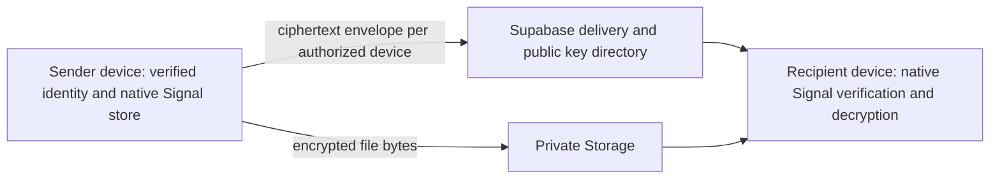

# Encryption integration assessment and design

**The application is not end-to-end encrypted.** Its existing direct/group message bodies and normal media remain readable by authorized Supabase infrastructure. Phase 4 did not replace them with an unvalidated cryptographic construction or silently relabel history. Device approval, TLS, private Storage, PINs and expiration are distinct protections.

## Evidence and library selection

Assessment date: 2026-10-15.

| Candidate | Evidence | Decision |
| --- | --- | --- |
| Signal's official Rust library via Java/JNI | [Upstream](https://github.com/signalapp/libsignal), [pinned release](https://github.com/signalapp/libsignal/tree/v0.86.5); used by Signal, native APIs expose identity keys, PQ prekeys, sessions and safety numbers. Upstream says external use is unsupported and APIs may change without notice. AGPLv3. | Selected for an isolated, executable native protocol probe. No claim that the application integration has been audited. |
| `libsignal` Dart binding 8.0.0 | Pub metadata reports publication 2026-10-08 and Dart ^3.10. [Repository](https://github.com/djx-y-z/libsignal_dart) documents a Rust bridge, Android support and Signal 0.105.0. Its current [security guidance](https://github.com/djx-y-z/libsignal_dart/blob/main/SECURITY.md) distinguishes message parsing from authentication and requires manual provenance verification in addition to binary checksums. | Promising mobile candidate, not rejected as unmaintained. No independent audit of this binding was located in this assessment. Its native artifacts, load-time resolution, store callbacks, crash consistency and Android behavior have not been validated here. Do not enable its unverified-download escape hatch. |
| `libsignal_protocol_dart` 0.8.2 | Pub metadata reports publication 2026-06-20; [repository](https://github.com/MixinNetwork/libsignal_protocol_dart) describes a pure Dart implementation with separate cryptographic dependencies. | A protocol port is not equivalent to the reviewed upstream implementation. No audit/protocol parity assessment was completed; not substituted into production. |
| Matrix/vodozem or MLS | Maintained protocol ecosystems with different room/device/server assumptions and native bindings. | Additional architecture and interoperability work would be needed; not a drop-in Supabase transport replacement. |

The underlying Signal protocol has published security analysis and specifications. That does not certify an arbitrary Flutter binding, key store, attachment format, device directory or application. Review requirements remain concrete engineering work, not a claim that no useful library exists.

## Executable native prototype

`security/prototype/SignalProtocolProbe.java` uses **official `org.signal:libsignal-client:0.86.5`**, not a mock cipher or a homemade ratchet. Its Maven JAR includes the Linux native implementation. Kotlin runtime dependencies and all three artifacts are pinned in `artifacts.lock.json`; hashes match official published Gradle metadata. Sources were inspected separately and excluded from the executable classpath. The runner cleans only its own class output before compiling.

```sh
SIGNAL_PROTOTYPE_CACHE=/workspace/toolchains/libsignal-prototype \
  python3 scripts/test-signal-prototype.py
```

Outside this environment the runner uses `.dart_tool/signal-prototype` and a JDK from JAVA_HOME/PATH. CI runs it in a separate JDK 21 job. TLS, pinned size and SHA-256 checks remain enabled; native binaries are not committed or included in the Flutter app. Observe AGPLv3 obligations when evaluating/distributing an integration; no production package-license decision is implied by this probe.

**17 native checks passed**: initial prekey agreement, one-time key consumption, bidirectional ratcheting, out-of-order/offline messages, replay denial, ciphertext tamper denial, valid-message recovery after tampering, signed-prekey rotation, delayed prior-session decryption, identity-change refusal, changed safety number, serialized session recovery, separate recipient-device sessions, wrong-device denial, attachment-key transport through Signal, GCM metadata binding and encrypted-file integrity rejection. Tests generate actual keys in memory and use standard JCE AES-256-GCM for the attachment experiment. They do not involve Supabase, Android Keystore, a Flutter crypto bridge, durable multi-device routing or physical devices.

## Required production architecture — not implemented yet



1. Pin a validated native bridge and exact native source/release artifacts. Verify provenance, APK ABI contents and release behavior on Android 10+. Fail closed on load/authentication errors. Do not fall back to sending a plaintext body when an encrypted session is unavailable.
2. Generate a separate cryptographic identity on each device. App-generated device UUIDs in Phase 4 are **not cryptographic identities**. Protect serialized identity/prekey/session records using a Keystore-wrapped key and an authenticated encrypted local store. The numeric calculator PIN is not an encryption key or an adequate recovery secret.
3. Build transactional native store adapters for identity trust, one-time/signed/PQ prekeys, ratchet/session records and skipped-message state. Session advancement, ciphertext outbox persistence and consumed prekeys must be committed atomically, including process death and restore/rollback tests. In-memory stores from the probe must never become production stores.
4. Publish only public, signed prekey bundles with device ownership, uniqueness and consumption constraints. Device-key registration/replacement must require an approved, recently authenticated session and an authenticated device-linking protocol. Account Auth plus a server-side device row alone does not protect against a malicious key directory.
5. Use reviewed multi-device session management such as [Sesame](https://signal.org/docs/specifications/sesame/) and the library's session protocol. Validate a signed device roster/epoch, establish independent sessions and fan out ciphertext to every approved recipient device and appropriate sender devices. Retry a stored ciphertext envelope instead of reusing a message key. Revocation must exclude devices from new key bundles, roster snapshots and delivery. Test races between send/link/revoke.
6. Include protocol version, conversation/message IDs, sender/recipient device identities, content type, attachment descriptors and expiration/view-once policy **inside the authenticated encrypted payload**. Verify them against routing expectations before displaying content. Parsing a Signal message is not authentication; use successful library decryption and explicit trust checks.
7. Use library safety numbers/QR verification and persist explicit verification state. A changed identity must warn/block sending until reviewed; do not silently replace trusted identities. Reinstall/lost-key recovery creates a new identity and independent verification. Never silently copy private identities between devices.
8. Encrypt files locally with an established, reviewed attachment construction and opaque object names; keep private filenames/descriptors inside the encrypted payload. Carry random file keys, authenticated descriptors and integrity material only inside Signal messages. Verify integrity before rendering, constrain decoded sizes and bound temporary plaintext lifetime. The JVM GCM probe is not a production streaming-media design or an audited file format.
9. Ciphertext transport needs new delivery/public-key tables and membership/device RLS, per-device acknowledgments, authenticated synchronization and replay/idempotency tests. Existing plaintext search/previews/edit/history endpoints must not receive decrypted content from encrypted conversations. Push stays generic.
10. Group encryption remains **not implemented**. A group requires a reviewed group protocol and authenticated membership/key epochs, including removal/rejoin/history rules. Do not reuse one-to-one keys or claim all chats are encrypted. LiveKit calls also have no E2EE claim.

## Key lifecycle and recovery

Identity keys remain device-local. Signed/PQ prekeys rotate using the selected library's supported lifecycle; one-time prekeys are consumed atomically and replenished under authenticated device ownership. Old decryption state must obey protocol bounds and expiration rules without re-enabling replay. New devices receive independently encrypted deliveries, not another device's raw private keys.

Lost-key recovery and historical sync require an explicit reviewed design: user-approved device transfer or a strong, separately protected encrypted backup with identity/rollback verification. Do not derive a backup key from the 4–8 digit calculator PIN. Device approval in this phase does not implement encrypted history transfer, backup recovery or key transparency.

## Historical plaintext migration

All existing messages remain historical plaintext-server records with their existing IDs and permissions. The three new migrations do not encrypt or relabel them. A future encrypted conversation must have an explicit version/epoch and a server-enforced prohibition on plaintext fallback. Default group chats must retain an explicit unencrypted label until their protocol exists.

Offer deliberate user choices for history: retain it as clearly labelled legacy history, delete it under the existing retention model, or perform an owner-authorized client-side re-encryption/import with new records and verified keys. Re-encryption cannot make formerly server-visible plaintext retroactively secret. Provider backups, WAL, screenshots and external copies may remain. Test mixed-version clients and prevent older clients from downgrading an encrypted conversation.

## Visible metadata and threats

Even a future implementation will reveal account/device identifiers, participants, public keys, ciphertext lengths, timestamps, IP/connection traffic, storage-object sizes and some routing/expiration/receipt metadata unless separately minimized. Supabase Auth and the service operator remain part of account authorization; a hostile key directory needs signed-device/identity verification defenses beyond RLS. The current app additionally exposes message bodies and media to its authorized backend.

The calculator gate protects ordinary access and previews. It cannot protect a rooted/compromised OS, a stolen unlocked process, malicious recipients, another camera, modified software, prior downloads or external backups. Dart/native/GPU memory erasure is best effort. Actual APK/plugin behavior, provider delivery, device linking, key persistence and release builds require the blocked Android/hosted validation before any production encryption claim.
